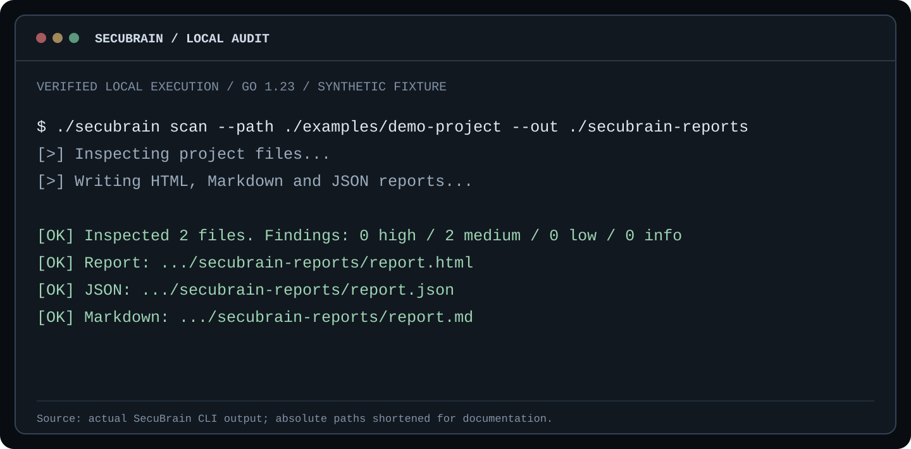
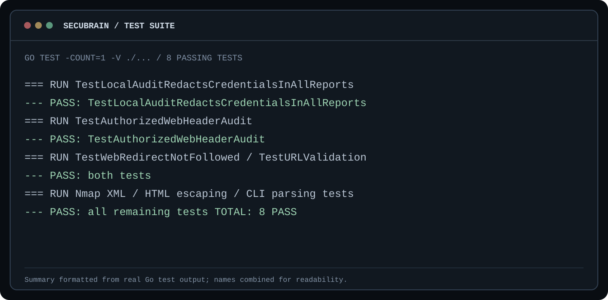
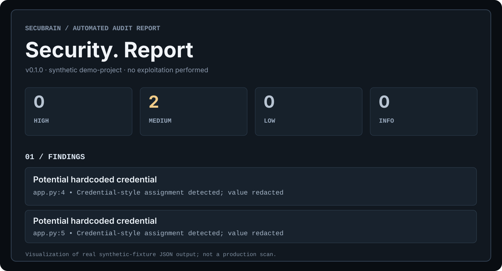

<div align="center">

<sub>SECURITY ENGINEERING &nbsp;/&nbsp; LOCAL-FIRST AUDITING &nbsp;/&nbsp; DETERMINISTIC EXECUTION</sub>

# SecuBrain<span>.</span>

**A minimal, evidence-oriented security auditing CLI — built in Go, without AI.**

Analyze a local codebase, inspect approved HTTP endpoints, optionally discover TCP services, and export structured findings to **HTML, Markdown, and JSON**.

[Getting started](#-quick-start) · [Documentation](#-documentation) · [Architecture](#-architecture) · [Security model](#-authorization--safety) · [Roadmap](#-roadmap)

<sub>v0.1.0 PROTOTYPE &nbsp;·&nbsp; WINDOWS / LINUX / MACOS* &nbsp;·&nbsp; NO CLOUD ACCOUNT &nbsp;·&nbsp; NO LLM</sub>

</div>

---

> [!IMPORTANT]
> **SecuBrain is a limited auditing prototype, not an automated penetration-testing platform.** Findings are indicators requiring review. A clean report does **not** mean a system is secure. Run remote checks **only** on systems you own or have explicit permission to assess.

## Overview

SecuBrain turns a few deliberate inputs into a reproducible audit workflow. Its core engine is entirely deterministic: it does not ask a language model to decide which commands to run, does not execute arbitrary chat instructions, and does not send source code to an AI provider.

```text
      LOCAL DIRECTORY                 AUTHORIZED URL
     (source & config)                (optional)
             |                            |
             v                            v
    +----------------+             +----------------+
    | File inspection|             | HTTP HEAD check|
    | Secret patterns|             | No redirects   |
    | .env hygiene   |             | Optional Nmap  |
    +----------------+             +----------------+
             |                            |
             +-------------+--------------+
                           |
                           v
                  FINDINGS + EVIDENCE
                  Severity / File / Line
                  Recommendation / Scope
                           |
                           v
                  REPORT GENERATOR
                   HTML / MD / JSON
```

### What makes it different?

- **Transparent operation.** Every enabled check is described and constrained.
- **No model dependency.** Runs locally with Go's standard library; no API key or Ollama required.
- **Evidence-first output.** Findings identify a pattern, location, context, severity, and possible remediation — without printing matched secret values.
- **Separation of scopes.** Local source inspection does not silently authorize remote network activity.
- **Portable reports.** Browse HTML, share sanitized Markdown, or integrate JSON with your own pipeline.
- **Minimal toolchain.** The core executable has no third-party Go packages. Nmap is an optional, separately installed adapter.

## Screenshots & verified output

The visuals below are **formatted captures of actual local test and CLI output**, generated using the included synthetic fixture on 8 Nov 2026. They are not depictions of a scan against a real production target.

### CLI — local fixture scan



### Automated test suite



### Report overview



The corresponding sanitized, machine-readable example is in [`docs/samples/demo-report.json`](docs/samples/demo-report.json). Details on the fixture: [`examples/README.md`](examples/README.md).

## Features at a glance

| Component | Implemented in v0.1.0 | Behavior |
|:--|:--:|:--|
| Interactive terminal | Yes | `scan`, `help`, `status`, `version`, `exit` |
| Local project audit | Yes | Recursive, bounded source/config inspection |
| Potential exposed secrets | Yes | Pattern-based indicators; values are not echoed |
| `.env` ignore review | Yes | Checks common `.gitignore` patterns for root `.env` |
| Web hardening | Yes | Exactly one `HEAD` request per URL; redirects not followed |
| Nmap integration | Optional | Limited TCP connect scan of one supplied hostname |
| Reports | Yes | HTML, Markdown, JSON |
| External AI / API integration | No | Intentionally not used |
| Metasploit / Hydra / exploitation | No | Not integrated |
| Dependency CVE matching / full SAST | No | Not yet implemented |
| Complete DAST / attack-surface discovery | No | Not yet implemented |

**Severity labels** express review priority within the scanner's rules, not verified exploitability. For example, an open port is **informational**, and a missing browser header may or may not matter for a particular application.

## Quick start

### 1. Requirements

- **Windows:** 64-bit Windows for the current `.exe` build. An installed Go toolchain is **not** needed to run that executable.
- **From source:** Go **1.23 or newer** (standard-library-only module).
- **Optional network port scan:** Nmap installed separately and available on `PATH`.
- **Local-only scan:** No network access or external services required.

### 2. Windows / PowerShell

Once you have the Windows x64 executable from a trusted build or future release, save it as `secubrain.exe` in a working directory and run:

```powershell
.\secubrain.exe version
.\secubrain.exe
```

Inside the interactive terminal:

```text
secubrain > scan --path "C:\Projects\my-app"
secubrain > status
secubrain > help
secubrain > exit
```

Or run an audit directly:

```powershell
.\secubrain.exe scan --path "C:\Projects\my-app" --out "C:\Audits\my-app"
```

> [!NOTE]
> An executable built locally is not necessarily signed. Prefer building from source or using a verified release. **This repository does not currently claim to provide signed binaries.**

### 3. Build from source (any supported Go target)

```bash
git clone https://github.com/twofern2ndes/SecuBrain.git
cd SecuBrain

go test ./...
go vet ./...
go build -o secubrain ./cmd/secubrain
./secubrain version
```

On Windows PowerShell with Go installed:

```powershell
go test ./...
go build -o secubrain.exe ./cmd/secubrain
.\secubrain.exe scan --path .
```

Cross-compile Windows x64 from a Linux/macOS shell:

```bash
GOOS=windows GOARCH=amd64 CGO_ENABLED=0 go build -o secubrain-windows-amd64.exe ./cmd/secubrain
```

Cross-compilation verifies the build process, **not runtime behavior on every operating system**.

### 4. Run a local audit

```bash
./secubrain scan --path ./examples/demo-project --out ./secubrain-reports
```

Expected result for the committed synthetic fixture (counts may change as detection rules evolve):

```text
[>] Inspecting project files...
[>] Writing HTML, Markdown and JSON reports...

[OK] Inspected 2 files. Findings: 0 high / 2 medium / 0 low / 0 info
[OK] Report: .../secubrain-reports/report.html
[OK] JSON:   .../secubrain-reports/report.json
[OK] Markdown: .../secubrain-reports/report.md
```

### 5. Inspect your own web endpoint

Use the exact endpoint you are authorized to test:

```bash
./secubrain scan --url https://your-owned-host.example --authorized
```

What happens: the tool sends **one `HEAD` request** (with a bounded timeout), reviews selected HTTP response headers, records non-exploitative advisories, and stops. It does not crawl, follow redirects, log in, or submit attack payloads.

Combine local and network checks if both scopes are yours:

```bash
./secubrain scan --path ./my-app --url https://your-owned-host.example --authorized --out ./my-audit
```

### 6. Optional: limited TCP discovery through Nmap

Install Nmap separately and make sure `nmap` is available on your system's `PATH`:

```bash
nmap --version
./secubrain scan --url https://your-owned-host.example --authorized --nmap
```

The adapter uses a single hostname extracted from the URL and executes Nmap **without a shell** using the argument array:

```text
-sT -Pn -F -T2 --max-retries 1 --host-timeout 30s -oX - <hostname>
```

This is a **bounded TCP connect scan of Nmap's fast/common ports**, not a vulnerability exploit or an exhaustive service inventory. A missing Nmap executable produces a warning and the rest of the audit can still run. The adapter has not been validated against every Nmap installation or network setup.

## CLI reference

| Command / flag | Meaning | Default |
|:--|:--|:--|
| `secubrain` | Start interactive terminal | — |
| `secubrain scan` | Run audit pipeline | — |
| `--path PATH` | Local folder to analyze | Optional when URL provided |
| `--url URL` | Exact authorized HTTP(S) endpoint | None |
| `--authorized` | Assert permission for remote checks | `false` |
| `--nmap` | Enable optional Nmap port discovery | `false` |
| `--out DIR` | Set report output directory | `./secubrain-reports` |
| `--max-files N` | Cap inspected file count | `5000` (max `50000`) |
| `--timeout DURATION` | HTTP request timeout | `8s` (max `60s`) |
| `version` | Show running binary version | — |
| `help` | Show usage | — |
| `status` | Show last successful report path, interactive only | — |
| `exit` / `quit` | Leave interactive mode | — |

Input rules: provide a local directory or URL. Remote checks require `--authorized`. URLs with query strings, fragments, or embedded credentials are rejected. A `--nmap` scan requires `--url`.

For exhaustive command behavior, see [`docs/cli-reference.md`](docs/cli-reference.md).

## How the engine works

### Phase 1 — Validation and scope

The engine resolves paths, confirms directories exist, normalizes output destinations, parses the URL, and validates limits. Network checks cannot start without the explicit authorization assertion. **No verification of legal ownership is performed** — that responsibility remains with the operator.

### Phase 2 — Local source inspection

The scanner traverses permitted file extensions and common configuration file names. It skips symbolic links, binary files, and dependency/build directories. Each matching line is reviewed for indicators including:

- Private-key PEM headers.
- Potential GitHub access-token patterns.
- AWS-style access-key identifiers.
- Credential-like assignments such as `password = "..."`.
- Presence of a root `.env` file without a common matching `.gitignore` rule.

Raw secret values are **not** placed in findings or rendered output. This is **pattern matching**, not credential validation, dataflow analysis, or proof that the credential is active.

**Resource bounds:** 1 MiB per individual file, 30 MiB aggregate inspected content, maximum 250 findings, and configurable file-count cap. Exceeding limits may cause incomplete results; heed scan warnings.

### Phase 3 — Web and Nmap adapters (opt-in)

- **Web:** sends a single `HEAD` to the supplied URL, does not follow redirect destinations, uses normal TLS verification, and advises about certain headers (`HSTS`, `X-Content-Type-Options`, `Content-Security-Policy`, frame restrictions) and plaintext HTTP usage where relevant.
- **Nmap:** optional subprocess with fixed arguments, XML output parsing, host-timeout bound, and open TCP ports reported as informational observations.

### Phase 4 — Correlation, prioritization, reporting

Findings receive stable IDs based on category, title, location, and line number, then are sorted by severity and location. The report generator writes three representations to the chosen directory. File permissions are restricted where the operating system supports them.

For architecture notes and a data-flow walkthrough, see [`docs/architecture.md`](docs/architecture.md).

## Output and report format

```text
secubrain-reports/
├── report.html     # Self-contained visual report; open in a browser
├── report.md       # Markdown summary for review and collaboration
└── report.json     # Structured automation-friendly result
```

Each finding includes an identifier, severity, category, title, description, redacted evidence, source location/line when available, and a recommendation. The JSON also includes scan timestamps, tool version, performed checks, warnings, and statistics.

Example (abbreviated; no genuine secrets):

```json
{
  "id": "SB-9645B30E",
  "severity": "medium",
  "category": "credentials",
  "title": "Potential hardcoded credential",
  "evidence": "Credential-style assignment detected; value redacted",
  "location": "app.py",
  "line": 4
}
```

For the complete documented shape and cautions on ingesting reports, see [`docs/report-format.md`](docs/report-format.md).

## Authorization & safety

**Allowed use:** local projects you control and explicit, bounded checks of authorized remote systems. Do not use SecuBrain to probe third-party infrastructure without permission.

- Local directory access **does not** imply permission to check live deployments.
- `--authorized` records a user assertion; it does **not** verify ownership or create legal authorization.
- No brute force, exploit payloads, login attempts, persistence, stealth, mass discovery, or arbitrary shell execution.
- Report files may reveal **file paths, system names, and endpoints** even though matching credential values are redacted. Treat reports as sensitive and avoid committing them.
- Do not paste real secrets into issue reports or public reproductions; use synthetic fixtures.
- The network layer may be affected by proxies, DNS, TLS configurations, and server behavior. Review target scope carefully before use.

The project's design boundaries and disclosure process are described in [`docs/security-model.md`](docs/security-model.md) and [`SECURITY.md`](SECURITY.md).

## Repository structure

```text
SecuBrain/
├── .github/
│   └── workflows/
│       └── ci.yml                 # Automated Go verification
├── cmd/
│   └── secubrain/
│       └── main.go                # Executable entry point
├── internal/
│   ├── audit/
│   │   ├── types.go               # Core models, validation, pipeline
│   │   ├── detectors.go           # Local static rule checks
│   │   ├── web.go                 # Single-request HTTP checks
│   │   ├── nmap.go                # Optional bounded Nmap adapter
│   │   ├── reports.go             # HTML, Markdown and JSON output
│   │   └── audit_test.go          # Auditing/safety tests
│   └── cli/
│       ├── cli.go                 # CLI & interactive commands
│       └── cli_test.go            # Command parsing tests
├── docs/
│   ├── assets/                     # Test-output visuals (SVG)
│   ├── make_assets.py              # Rebuild documentation diagrams
│   ├── samples/                    # Redacted demonstration JSON
│   ├── architecture.md
│   ├── cli-reference.md
│   ├── report-format.md
│   ├── security-model.md
│   └── development.md
├── examples/
│   ├── README.md
│   └── demo-project/              # Synthetic test fixture
├── .gitignore
├── CONTRIBUTING.md
├── SECURITY.md
├── go.mod
└── README.md
```

No generated audit output, real `.env`, compiled binaries, or private keys should be checked into the repository.

## Testing & quality

```bash
go test -count=1 -v ./...
go vet ./...
go test -race ./...    # Where the Go race detector is supported
```

The v0.1 suite currently has **8 passing tests** covering secret-value redaction, authorization gating, HTTP `HEAD` behavior, redirect isolation, URL validation, Nmap XML parsing, HTML escaping, and command-line parsing.

A local test pass is a snapshot, not a claim of production readiness. See [`docs/development.md`](docs/development.md) for reproducible steps.

## Roadmap

| Stage | Goal | Status |
|:--|:--|:--|
| 0.1 | Deterministic CLI, bounded local scanning, web headers, optional Nmap, 3 report formats | **Current prototype** |
| 0.2 | Better rules and language-aware static analysis; richer configuration | Planned |
| 0.3 | Versioned report schema, report diffing, additional tests | Planned |
| 0.4 | Opt-in safe integrations (e.g., Semgrep / Trivy) and dependency inventory | Proposed |
| 1.0 | Stable API/CLI contracts, documented releases, reproducible signed packages | Long-term goal |

Roadmap items are **not** implemented features or delivery commitments.

## Documentation

- [Architecture and execution pipeline](docs/architecture.md)
- [Complete CLI reference](docs/cli-reference.md)
- [JSON report structure](docs/report-format.md)
- [Safety boundaries and scope controls](docs/security-model.md)
- [Development and test workflow](docs/development.md)
- [Safe demo fixture](examples/README.md)
- [Contributing](CONTRIBUTING.md) · [Security policy](SECURITY.md)

## Contributing & support

Issues and pull requests are welcome for bug reports, documentation, additional safe detection rules, tests, and portability fixes. Read [`CONTRIBUTING.md`](CONTRIBUTING.md) before opening a PR. For vulnerabilities in SecuBrain itself, use the process in [`SECURITY.md`](SECURITY.md) rather than filing public exploit details.

**License:** No open-source license has been selected yet. The repository is publicly readable, but that alone does not grant permission to redistribute or reuse its contents. A license decision will be documented explicitly before an open-source release.

---

<div align="center">

<sub>SECUBRAIN &nbsp;·&nbsp; BUILT WITH GO &nbsp;·&nbsp; DETERMINISTIC BY DESIGN</sub>

**Maintained by [twofern2ndes](https://github.com/twofern2ndes)**

<sub>Understand the system. Collect evidence. Report responsibly.</sub>

</div>