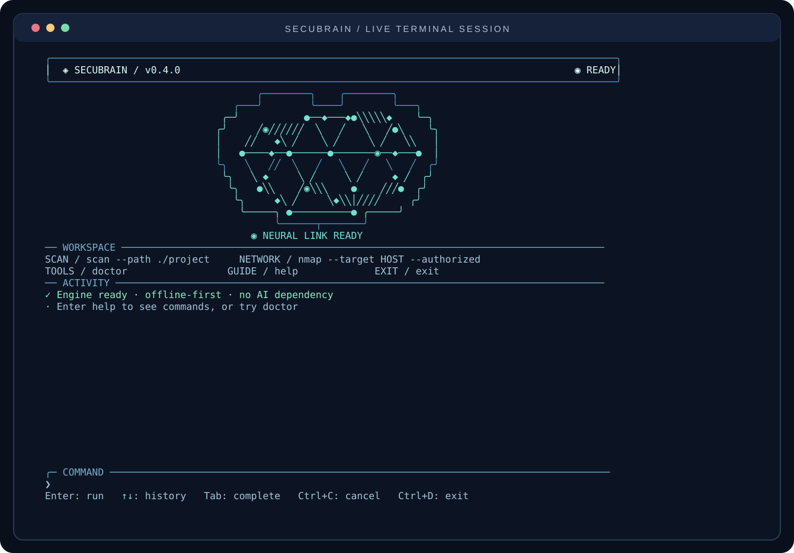
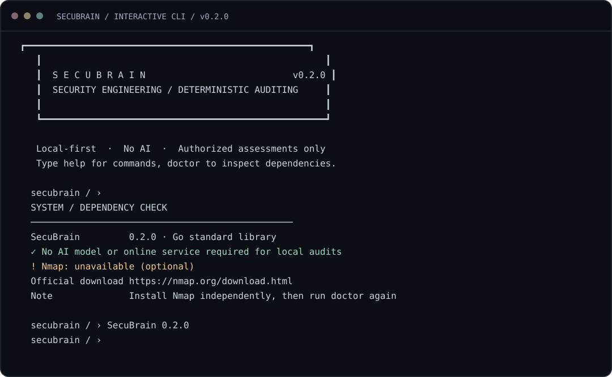
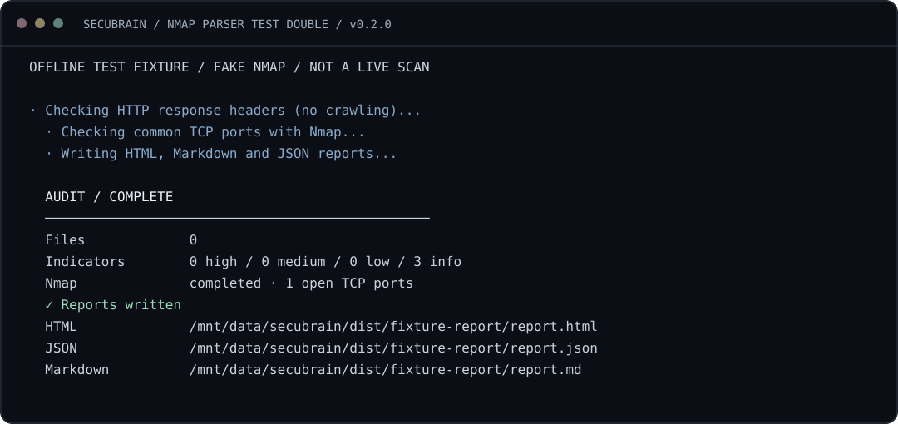
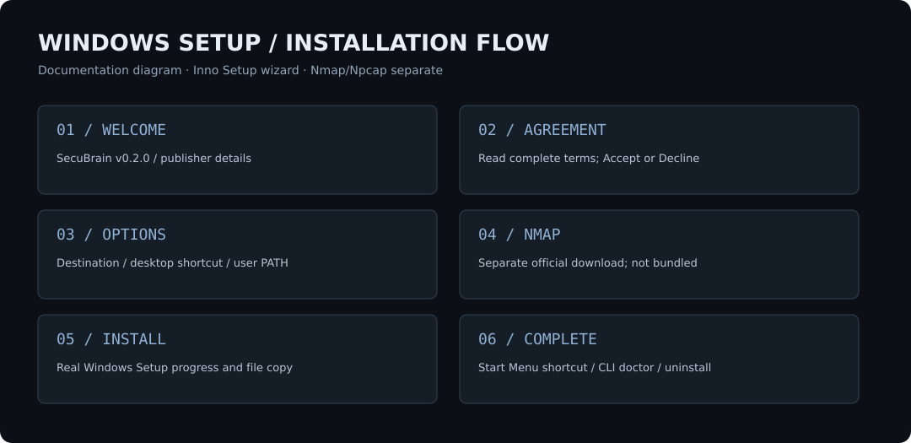

<p align="center"><sub>SECURITY ENGINEERING &nbsp; / &nbsp; NETWORK DISCOVERY &nbsp; / &nbsp; EVIDENCE-DRIVEN AUDITING</sub></p>

<h1 align="center">SecuBrain.</h1>

<p align="center"><strong>Deterministic security auditing CLI in Go, with a real Nmap integration.</strong></p>

<p align="center">Inventory a single authorized network host, inspect local source code, review HTTP response headers and export locally stored HTML, Markdown and JSON reports.</p>

<p align="center"><a href="https://github.com/twofern2ndes/SecuBrain/releases/tag/v0.4.0">Windows release</a> · <a href="#quick-start">Quick start</a> · <a href="docs/nmap-integration.md">Nmap guide</a> · <a href="docs/architecture.md">Architecture</a> · <a href="SECURITY.md">Security policy</a></p>

<p align="center"><sub>v0.4.0 PRERELEASE &nbsp; / &nbsp; GO 1.23+ &nbsp; / &nbsp; WINDOWS X64 INSTALLER &nbsp; / &nbsp; NO AI REQUIRED</sub></p>

---

> [!IMPORTANT]
> **Authorized targets only.** SecuBrain is a development-stage auditing tool, not a penetration-testing suite, compliance certification or vulnerability proof. You are responsible for obtaining explicit permission before any remote scan. An open port or service banner does not establish a vulnerability.

## Overview

SecuBrain brings separate diagnostic checks into a reproducible CLI workflow. The v0.4 terminal experience introduces a responsive, full-screen neural dashboard for interactive work, with unchanged deterministic audit behavior. It does not execute natural-language commands, ask an AI model to operate tools or invoke a shell to build network scans. A user-installed **Nmap** supplies real TCP/optional UDP scanning; the first-party Go code controls scope, interprets XML and records evidence. No Nmap or Npcap executable is bundled.

```text
                 Explicit operator input
           (local path / one approved URL /
             one approved IP or hostname)
                            |
             +--------------+--------------+
             |              |              |
             v              v              v
       SOURCE SCANNER     HTTP HEAD       NMAP PROCESS
       bounded file       response        real installed
       inspection         headers         nmap executable
             |              |              |
             +--------------+--------------+
                            |
                  NORMALIZED RESULTS
               inventory / findings /
                warnings / metadata
                            |
                 JSON + HTML + Markdown
                     (local files)
```

### Implemented in v0.4

| Capability | Implementation |
|---|---|
| **Animated neural dashboard** | Original brain-and-neural-network animation with live pulses, command input, history, cancellation and responsive terminal layouts; zero external Go UI dependencies |
| **Safe fallback mode** | Automatically keeps the plain console for non-TTY streams, CI, reduced-motion and incompatible terminals |
| **Nmap detection** | Locate via `PATH`, standard Windows install paths, explicit `--nmap-bin` or `SECUBRAIN_NMAP_PATH`; query installed version |
| **Quick Nmap profile** | Nmap `-F` (~100 common TCP ports), light service/version probes |
| **Standard Nmap profile** | Nmap's ~1000 common TCP ports, moderate version intensity |
| **Full TCP Nmap profile** | All **65,535 TCP ports** via `-p-`, more detailed service/version probes |
| **Optional UDP discovery** | `--nmap-udp`; on full scans UDP 1–1024, not the whole UDP space |
| **Optional advanced Nmap metadata** | `--nmap-os` and `--nmap-scripts` for OS estimates and **default** NSE results (off unless requested) |
| **Detailed network inventory** | Host status/addresses, ports/states/reasons, product/version, CPE, OS guesses, NSE script IDs/output |
| **Local source inspection** | Bounded recursive file patterns and potential exposed-secret indicators; secrets not echoed |
| **HTTP headers** | One HEAD request to an explicitly authorized URL, without following redirects |
| **Reports** | JSON canonical inventory plus HTML and Markdown review documents |
| **Windows setup** | Inno Setup wizard, license acceptance, optional user PATH/shortcuts, uninstaller, Nmap prerequisite guidance |
| **Automated checks** | Go tests/vet/race, real PTY dashboard smoke, Ubuntu real-Nmap loopback CI and Windows installer validation |

Not implemented: AI assistants, Metasploit, Hydra, credential attacks, vulnerability exploitation, CVE validation, arbitrary NSE scripts, mass-target/CIDR scanning, or all Nmap capabilities. The `full` profile is **full TCP port coverage**, not unlimited network assessment.

## Quick start

### 1. Install SecuBrain

For Windows x64, use the [v0.4.0 GitHub prerelease](https://github.com/twofern2ndes/SecuBrain/releases/tag/v0.4.0) once the CI-validated installer appears. The guided installation contains terms, selected folder, PATH option, optional shortcuts, and uninstall support. Source builds also work on Linux/macOS/Windows:

```bash
git clone https://github.com/twofern2ndes/SecuBrain.git
cd SecuBrain
go build -o secubrain ./cmd/secubrain
./secubrain version
```

### 2. Install Nmap separately

Obtain Nmap from **[nmap.org/download.html](https://nmap.org/download.html)** and follow the official license and installer prompts. On Windows, installation of Npcap may be needed for raw-packet features. Then run:

```powershell
secubrain doctor
```

For a nonstandard Nmap installation, use `--nmap-bin "C:\\Tools\\Nmap\\nmap.exe"` or `SECUBRAIN_NMAP_PATH`. The installer does **not** silently download or bundle Nmap/Npcap, because their third-party redistribution terms must be respected.

### 3. Run a permitted Nmap audit

```powershell
# Quick, ~100 common TCP ports
secubrain nmap --target 192.0.2.10 --authorized --nmap-profile quick

# Standard, ~1000 common TCP ports (default)
secubrain nmap --target 192.0.2.10 --authorized --nmap-profile standard

# All 65535 TCP ports; long-running, use only in an approved maintenance window
secubrain nmap --target 192.0.2.10 --authorized --nmap-profile full --out C:\\Audits\\my-host

# Additional tests, may require administrator/root privileges and Npcap
secubrain nmap --target 192.0.2.10 --authorized --nmap-profile standard --nmap-udp --nmap-os --nmap-scripts
```

`192.0.2.10` is documentation-only address space. Replace it with **a specific address you own or have written permission to assess**. Do not use a public domain or private corporate IP without authorization.

You can combine an approved URL and Nmap by passing `secubrain scan --url https://your-approved-host.example --authorized --nmap`. The tool derives **only that URL's hostname**. Local-only scans use `secubrain scan --path ./project` with no network access.

### 4. Review results

Every audit writes a local folder:

```text
secubrain-reports/
  report.json       # full structured host + port inventory
  report.html       # escaped human-readable summary and discoveries
  report.md         # lightweight Markdown evidence report
```

`nmap.hosts[].ports[]` records port protocol, number, state, reason, service, product, version, CPE and optional NSE results. `nmap.hosts[].extra_port_states` preserves aggregated counts from Nmap's XML; the tool does **not** invent individual details for ports summarized by Nmap. Only confirmed `open` TCP/UDP ports become **informational** findings. `open|filtered`, filtered and closed ports are not classified as open vulnerabilities. Output sizes are bounded and HTML/Markdown limit previews; JSON retains all normalized inventory within the XML cap.

**Failure visibility:** missing Nmap or a failed Nmap run produces a **nonzero exit code** while saving an error/partial report where possible. Inspect `nmap.status` and `warnings` before relying on results. An unsuccessful scan or an empty report does **not** prove that a host is secure.

See [report schema](docs/report-format.md) and the full [Nmap integration guide](docs/nmap-integration.md).

## Test fixtures and screenshots

The animated dashboard preview below is rendered from a captured, real local PTY session, not generated artwork.



See the [terminal experience documentation](docs/terminal-experience.md) for controls, accessibility and testing, and the [five reproducible verification gates](docs/quality-gates.md).

The following images were generated from earlier **synthetic fixtures and local CLI tests** for illustration. In particular, the Nmap diagram uses a fake Nmap process, **not a real production scan**. The project also runs a *real Nmap loopback check in CI*, which is independent of these images.

| SecuBrain sample terminal | Nmap adapter fixture |
|---|---|
|  |  |




## Repository structure

```text
cmd/secubrain/               CLI entrypoint
internal/cli/                commands, options and interactive command bridge
internal/ui/                 animated dashboard, keyboard parser, neural renderer
internal/audit/              scope validation, real Nmap adapter,
                             local/HTTP scanners, JSON/HTML/MD reports
internal/audit/testdata/     no-network Nmap test double
docs/                        architecture, CLI guide, Nmap details,
                             report schema, assets and release notes
installer/                   Inno Setup source and original visual assets
legal/                       installation terms and third-party notices
.github/workflows/           Go CI, real Nmap loopback, Windows installer
website/                     static documentation/download landing page
examples/                    synthetic demonstration input
```

## Build and test

```bash
go test -count=1 ./...
go vet ./...
go test -race -count=1 ./...
go build ./cmd/secubrain
```

Cross-compile the CLI from Linux/macOS with `GOOS=windows GOARCH=amd64 go build -o secubrain.exe ./cmd/secubrain`. The **Windows installer** itself is compiled using Inno Setup 6 on a Windows runner. Its GitHub Actions workflow runs tests, compiles the installer, performs silent install/version/doctor/uninstall smoke checks and only publishes a prerelease after the prerequisite CI checks pass.

The local fake Nmap test executable verifies process invocation without sending packets. The actual Nmap check in GitHub Actions is restricted to a temporary HTTP listener on **127.0.0.1** inside the authorized CI runner. This coverage does not guarantee Npcap, privileged scanning or compatibility on every computer.

## Legal, privacy and security

SecuBrain and Nmap are independent projects. **Nmap** is distributed under the [Nmap Public Source License](https://nmap.org/npsl/), and Npcap has separate redistribution conditions. The [Nmap Project's licensing page](https://nmap.org/oem/) explains OEM redistribution rights. The SecuBrain installer contains **no Nmap/Npcap binary or driver**; the user installs them separately. The optional scripts and UDP/OS probes can cause extra traffic, require privileges and have additional operational risks.

All network checks must be limited to infrastructure the operator owns or is explicitly authorized to audit. Reports can contain sensitive topology/service information and should be stored and shared according to organization policy. The installation agreement clarifies the experimental state, intended professional/educational use, limitations and applicable liability notices **to the extent legally permitted**; no notice overrides applicable law or third-party rights.

- [Security and disclosure](SECURITY.md)
- [Installation and acceptable-use terms](legal/INSTALLER-TERMS.txt)
- [Windows installation](docs/windows-installer.md)
- [Architecture](docs/architecture.md)
- [Contributing](CONTRIBUTING.md)

The public availability of this source tree does not automatically grant open-source redistribution rights in the absence of a separately published first-party source license. Nmap/Npcap retain their own licenses.

## Roadmap

- Stabilize Nmap XML edge cases and add optional authorized Windows+Npcap smoke tests.
- Improve text editing and consider native ConPTY integration for additional Windows terminal variants.
- Improve target/asset inventory export, diagnostics and error classification.
- Continue usability and accessibility work **after** the auditing engine is stable.
- Evaluate other defensive scanning adapters in future releases, each with explicit operator scope, independent licenses and reproducible tests.

**Maintained by [twofern2ndes](https://github.com/twofern2ndes).** For issues, use the repository issue tracker. Never publish unauthorized scan output or live credentials in public issues.
