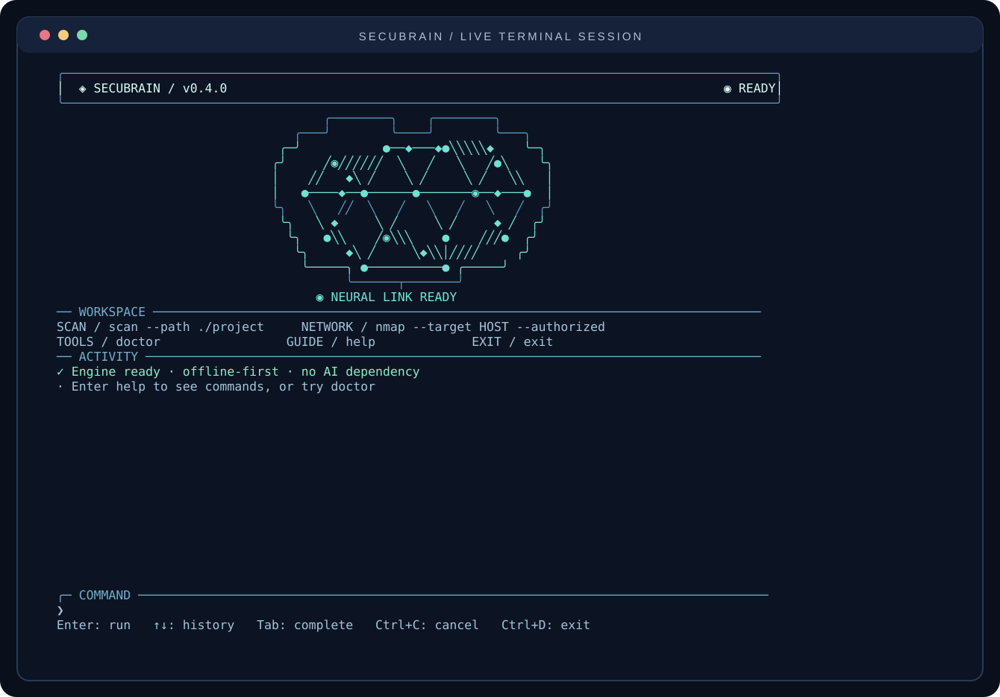

# Terminal experience / SecuBrain v0.4.0

The v0.4 user interface is original Go code. It does not repackage Claude Code,
Codex, Hermes, or any other product. The project preserves the deterministic
scanning engine, network authorization checks, and report outputs from v0.3.



## Terminal-first design

- **Neural visualization:** procedural brain outline, connecting neuron graph,
  moving impulses and status captions generated as terminal characters.
- **Activity:** bounded activity feed for progress, errors and completion.
- **Command prompt:** direct editing, UTF-8 support, left/right movement,
  command history and Tab completion for built-in commands.
- **Safe asynchronous work:** audit engine executes in a cancellable Go context
  while the terminal continues rendering and accepting keyboard input.
- **Responsive:** compact layout for narrow/short terminals; no multiline escape
  dump into CI logs or redirected output.
- **No AI dependency:** animated neurons are a visualization, not a neural
  network, a model, or autonomous decision logic.

The dashboard uses no third-party Go UI dependencies, sends no telemetry,
performs no network requests itself, and spawns no subprocesses except those
requested by existing, explicitly authorized audit commands.

## Controls

| Shortcut | Behavior |
|---|---|
| `Enter` | Execute the command in the input line |
| `↑` / `↓` | Browse bounded command history |
| `←` / `→` | Move text cursor |
| `Home` / `End` | Go to start/end of command when supported by terminal |
| `Backspace` / `Delete` | Edit the current command |
| `Tab` | Complete a built-in command prefix |
| `Ctrl+A` / `Ctrl+E` | Beginning/end of input |
| `Ctrl+U` | Clear current command |
| `Ctrl+L` | Clear activity feed |
| `Ctrl+C` | Cancel the currently running operation; otherwise clear input |
| `Ctrl+D` | Exit if input empty and no command is active |
| `exit` | Exit when no operation is running |

### Commands from the dashboard

```text
scan --path ./local-project --out ./reports
nmap --target 127.0.0.1 --authorized --nmap-profile quick
doctor
help
status
history
clear
exit
```

A network scan is **never authorized by opening the dashboard**. The regular
`--authorized` flag and single-host scope validation remain mandatory. All
existing non-interactive commands retain their normal behavior.

## Compatibility and accessibility

The animated dashboard uses the Windows 10+ virtual terminal input/output
modes or Linux terminal settings. macOS and other unsupported raw-mode
platforms currently use the simpler, plain interactive prompt.

When input/output are redirected or the terminal does not support necessary
modes, SecuBrain uses the original line-oriented CLI. Do not parse dashboard
frames as machine output: use `secubrain scan` or `secubrain nmap` directly and
consume the generated JSON report.

| Environment | Setting | Effect |
|---|---|---|
| CI runner | `CI=1` | Disable dashboard entirely |
| Plain console | `SECUBRAIN_PLAIN=1` | Force line-oriented interface |
| Reduced motion | `SECUBRAIN_REDUCED_MOTION=1` | Render a static neural illustration |
| No animation | `SECUBRAIN_NO_ANIM=1` | Disable motion and refresh ticker |
| No ANSI styling | `NO_COLOR=1` | Fall back to original simple prompt |
| Dumb terminal | `TERM=dumb` | Fall back to original simple prompt |

For Windows, use Windows Terminal or a modern PowerShell/Command Prompt console.
Terminals that cannot support the input mode are not forced into partial raw
mode; they fall back without affecting existing commands. The Windows CLI
binary is a standard console program, not a separate GUI.

## Performance, reliability, and test coverage

- Rendering updates at **up to 10 frames per second**. If animation is disabled,
  the idle refresh ticker is disabled too.
- Activity history is limited to 160 entries; command history to 60; input to
  2,048 Unicode code points; each displayed log entry is bounded.
- Control characters from scanner output are sanitized before drawing.
- Frame generation is pure and can be tested without any terminal devices.
- Linux automated PTY smoke exercises actual animated launch, keyboard input,
  `help`, `version`, `doctor`, clean exit and alternate-screen restoration.
- Real local code scan tests confirm the dashboard bridge still creates HTML,
  Markdown and JSON reports. Existing Nmap tests and Windows installer smoke
  remain part of CI.

A cross-compiled Windows executable is **not** proof that all Windows terminal
emulators have been tested. Windows-native build and automated installer smoke
cover installation and basic command dispatch; the visual terminal path may
vary with host console and font support. This prerelease is not formally
performance certified.

## Reproducing the terminal preview

On Linux:

```bash
go build -o secubrain ./cmd/secubrain
python3 docs/pty_smoke.py
python3 docs/render_terminal_preview.py dist/dashboard-pty-capture.ansi
```

The SVG is derived from terminal output emitted by the actual executable.
The color styling is applied during SVG formatting; it is not a claim that
any remote target was scanned or that an AI model was involved.
